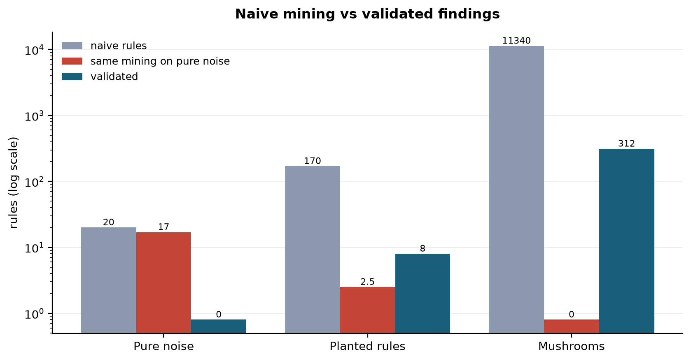

# Case studies

Generated by `python case_studies.py` (40 null replicates per dataset).

| dataset | ground truth | naive rules | distinct hypotheses | ghost rate | validated | top finding |
|---|---|---|---|---|---|---|
| Pure noise | none: every rule is a ghost | 20 | 20 | 17.0 | 0 | none |
| Planted rules | 2 planted rules | 170 | 14 | 2.5 | 8 | {promo=yes, weekend=yes} -> {basket=large} |
| Mushrooms | strong real structure | 11340 | 312 | 0.0 | 312 | {gill_spacing=c, stalk_surface_above_ring=k} -> {Mushroom_quality=p} |

On the planted data, every validated rule involves only the planted columns (weather, delay, promo, weekend, basket). Extra survivors restate the two effects, for example the reverse direction or the complement (`weather=cloud -> delay=no`). No noise column survives.

