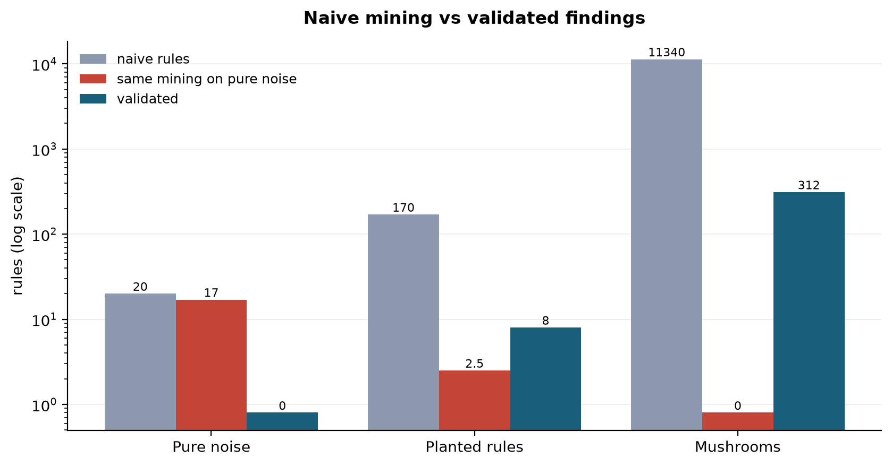

# Ghost Patterns

> **Data-mining tools always find something. This one tells you which of it is real.**

[](https://github.com/your-username/ghost-patterns-v2/actions/workflows/ci.yml)
[](https://www.python.org/)
[](LICENSE)

Apriori returns rules on shuffled data. k-means returns k clusters from pure
static. Isolation Forest flags its contamination quota no matter what you feed
it. So "I found patterns" is not a result.

**Ghost Patterns** makes it one. It runs your exact mining pipeline on
*structurally matched noise*, then keeps only the findings that beat what the
noise produced. It also catches leakage (patterns that are true by
construction) before you mine, and it measures its own false-positive rate.



| Dataset | Ground truth | Naive rules | Same mining on pure noise | Validated |
|---|---|---:|---:|---:|
| Pure noise | nothing to find | 20 | 17.0 | **0** |
| Planted rules | 2 planted effects | 170 | 2.5 | **8**, all restating the 2 planted effects |
| UCI Mushrooms | predict edibility | 11,340 | 0.0 | **312** rules predicting edibility |

Reproduce with `python case_studies.py`. Details in [CASE_STUDIES.md](CASE_STUDIES.md).

---

## Three ways to use it

### 1. Command line

```bash
pip install .
ghostpatterns analyse mushrooms.csv --target Mushroom_quality --open
```

`--target` asks one question ("what predicts this column?") instead of
testing every possible column pair. That makes the results far sharper.
`--open` opens the report in your browser when the run finishes.

Everything is written to `results/<dataset>/`:

| File | Contents |
|---|---|
| `report.html` | Self-contained interactive report: searchable, sortable, plain-English verdicts, embedded figures. Works offline and can be shared as one file. |
| `report.md` | Same report as Markdown, renders on GitHub |
| `rules_all.csv`, `rules_survivors.csv` | Every rule with lift, confidence, p, q, FWER p and verdict |
| `leakage.csv`, `column_attribution.csv` | Leakage findings; which columns carry the structure |
| `clusters_*.csv`, `anomalies.csv` | Calibrated clustering and anomaly results (numeric data) |
| `figures/*.png`, `log.txt` | All plots; full console output |

Other commands:

```bash
ghostpatterns leakage data.csv       # leakage check only; exit code 2 if found (CI-friendly)
ghostpatterns benchmark --quick      # measure the validator's own error rates
ghostpatterns figures                # regenerate the explainer figures
ghostpatterns analyse --help         # every option
```

### 2. Web app

```bash
pip install ".[app]"
ghostpatterns app
```

Upload a CSV (or use the built-in demo dataset), pick the column to explain
and press **Run**. You get live progress, filterable results tabs and
one-click downloads of the HTML report or a ZIP of everything. The data stays
on your machine.

### 3. Python library

```python
import pandas as pd
from ghostpatterns.analyse import Options, analyse, save

df = pd.read_csv("mushrooms.csv")
result = analyse(df, Options(target="Mushroom_quality", n_null=100))

print(result.headline())
print(result.rules.survivors.head())
save(result, "results/mushrooms")      # CSVs, figures, report.md, report.html
```

The lower-level building blocks (`rules`, `nullmodels`, `leakage`,
`clusters`, `anomaly`, `pipeline`) are all public too.

---

## What it checks

| Step | Question it answers | How |
|---|---|---|
| **Leakage** | Is any pattern true by construction? | Functional dependencies, duplicate encodings, sorted rows, arithmetic totals |
| **Rules** | Which rules beat noise? | Apriori, then redundancy filtering, then per-rule FDR and family-wise tests against a null distribution |
| **Attribution** | Which columns carry the structure? | Shuffle one column at a time and measure what disappears |
| **Clusters** | Is k-means finding anything real? | Silhouette and gap statistic against matched null data, plus stability |
| **Anomalies** | Are there more outliers than noise produces? | Score distribution against null; checks whether distances still mean anything in this dimensionality |

---

## Benchmark results and empirical validation

### 1. Signal recovery vs noise rejection
*Planted signal: 2 real rules hidden among 18 pure-noise columns across 1,500 rows.*

| Mining stage | Rule count | Quality |
|---|:---:|---|
| **Naive Apriori** | 451 | Overwhelmed by noise artifacts |
| **After redundancy filtering** | 166 | Padded variants removed |
| **Ghost baseline (mean null run)** | 113 | Expected noise discoveries |
| **Survived ghost calibration** | **8** | **All signal (no noise columns in survivors)** |

### 2. Statistical significance vs practical meaning
*Demonstrated on lottery draw datasets (sorted balls and engineered arithmetic features).*

- **Naive mining** (sorted balls and derived features): **280 rules survive** standard statistical tests. All are real dependencies, and all are trivial artifacts of sorting or arithmetic.
- **Honest mining** (raw draw order, no derived features): **0 rules survive.**
- **Takeaway:** significance confirms a dependence exists; `check_leakage` tells you whether it is meaningful or self-inflicted.

### 3. Null model choice matters
*Synthetic market-basket data with varied basket sizes and zero real item affinity.*

| Null model | Ghost rate (per run) | Max ghost lift | Spurious discoveries |
|---|:---:|:---:|:---:|
| **`IndependentShuffle`** (destroys basket-size distribution) | 2.7 | 1.24 | **292** |
| **`SwapRandomization`** (preserves row and column margins) | 445.8 | 8.21 | **0** |

`IndependentShuffle` on basket data destroys row margins, so co-occurrences in
large baskets look extraordinary when they are purely mechanical. Choosing the
null model is a modelling decision, not a default.

### 4. Validator diagnostics

| Metric | Value | Target |
|---|:---:|:---:|
| False positive rate (family-wise) | **0.0%** | ≤ 5.0% |
| Minimum detectable effect (80% power) | **0.30** | |
| Power at effect 0.50 | **100%** | |
| Recall at effect 0.35 | **100%** | |

---

## Null models

| Null model | Preserves | Destroys | Use for |
|---|---|---|---|
| `IndependentShuffle` | Exact column marginals | All cross-column dependence | Standard tabular data |
| `MarginalResample` | Marginal distributions | Exact value frequencies | Data with extreme rare values |
| `GaussianMatched` | Means and covariance | Higher-order interactions | Clustering validation |
| `UniformHull` | Bounding box | Density variations | Classic gap statistic |
| `BlockShuffle` | Short-range autocorrelation | Long-range trends | Time series |
| `PhaseRandomized` | Full power spectrum | Nonlinear structure | Financial returns, signals |
| `SwapRandomization` | **Row and column margins** | Specific item affinity | **Market-basket / transaction data** |
| `ConditionalPermutation` | **All pairwise dependence** | Higher-order interactions | Testing whether {A,B}→C beats A→C plus B→C |

---

## Method notes

### Sampling-error redundancy threshold
When rule {A}→{C} has high lift, padded variants like {A, noise}→{C} often
score higher purely because lift estimated on a smaller subsample is noisier.
A child rule is kept only if it beats its parent by more than

$$\text{margin} = z \cdot \frac{\text{lift}_{\text{parent}}}{\sqrt{N_{\text{child}}}}$$

### The replicate guard
With $R$ null replicates the smallest attainable empirical p-value is
$p_{\min} = 1/(R+1)$. If $p_{\min} > \alpha$ the test can never reject, and
would silently report "nothing found". `significance.check_replicates` warns
before that happens.

---

## Project layout

```
ghostpatterns/
├── cli.py           ghostpatterns command (analyse, leakage, benchmark, figures, app)
├── analyse.py       end-to-end analysis: analyse() computes, save() writes outputs
├── report.py        Markdown and self-contained interactive HTML reports
├── app.py           Streamlit web app
├── datasets.py      built-in datasets with known ground truth
├── pipeline.py      one-call rule pipeline with reproducibility manifest
├── leakage.py       leakage and structural-artifact detection
├── nullmodels.py    8 null model generators
├── rules.py         Apriori, redundancy filtering, target focus, FDR/FWER calibration
├── clusters.py      null-calibrated silhouette, gap statistic, stability
├── anomaly.py       calibrated anomaly detection, dimensionality diagnostics
├── permutation.py   single-column attribution
├── significance.py  empirical p-values, replicate guard
├── benchmark.py     measures the validator's own FPR, power and FDR
└── viz.py           figures
```

## Development

```bash
pip install -e ".[app,dev]"
pytest                               # full test suite
python demo.py                       # core experiments, ~15 min
python demo_advanced.py              # leakage, null choice, benchmark, ~10 min
python case_studies.py               # regenerates the table and figure above
```

## Limitations

- **Existence, not meaning.** A null model tells you whether structure exists,
  not whether it matters in your domain.
- **The null must fit the data.** Results are only as valid as the null
  model's match to how the data was generated (see *Null model choice matters*).
- **Compute.** Every replicate reruns the full mining, so large datasets with
  many replicates take minutes.

## License

MIT. See [LICENSE](LICENSE).
